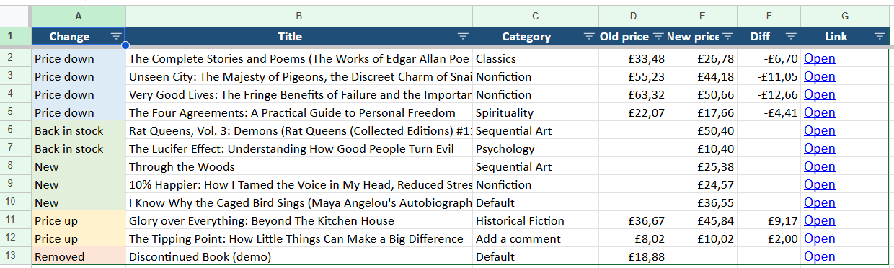
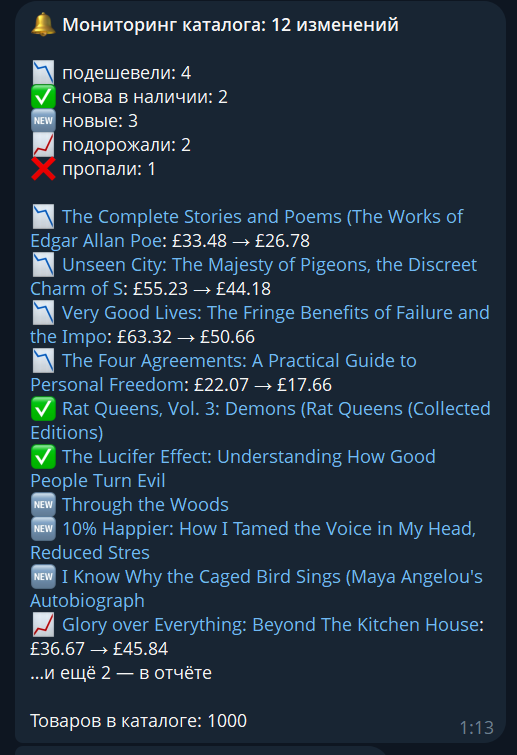

# Price Monitor — web scraper with Excel reports and Telegram alerts

Scrapes an online store catalog, compares it with the previous run and reports what changed: price drops and increases, new and removed products, stock changes. Results go to a formatted Excel report and a Telegram message.

Demo target: [books.toscrape.com](https://books.toscrape.com) — a sandbox site built for scraping practice (1,000 products, 50 categories).


## ✨ Features

- 🕷 **Full catalog scraping** — all categories and pagination, 1,000 products in ~5 seconds (parallel requests, retries on network errors)
- 🔍 **Change detection** — compares with the previous snapshot:
  📉 price down · 📈 price up · 🆕 new · ❌ removed · ✅ back in stock · ⛔ out of stock
- 📊 **Excel report** with three sheets:
  - **Changes** — what changed, old/new price, difference, color-coded
  - **Catalog** — all products with filters, frozen header, price color scale, clickable links
  - **Summary** — per category: number of products, average / min / max price, average rating
- 🔔 **Telegram alert** — short summary + top changes with links, and the Excel report attached as a file
- ⏰ **Ready for scheduling** — run daily via Windows Task Scheduler or cron

## 📸 Screenshots

**Excel report — "Changes" sheet**



**Telegram alert** (the Excel file is attached right after the message)



## 🧱 Project structure

```
main.py          — entry point: scrape → compare → Excel → Telegram
scraper.py       — catalog scraping (requests + BeautifulSoup)
compare.py       — snapshot storage and change detection
export.py        — formatted Excel report (openpyxl)
notify.py        — Telegram message + report file
demo_changes.py  — simulates "yesterday's" data to demo change detection
```

## 🚀 Run

```bash
python -m venv .venv
.venv\Scripts\activate
pip install -r requirements.txt

python main.py              # scrape + Excel report (first run saves a baseline)
python main.py --notify     # same + Telegram alert (fill BOT_TOKEN and CHAT_ID in .env)
```

**Demo of change detection:** prices on the sandbox site never change, so run `python demo_changes.py` after the first run — it edits the saved snapshot as if the catalog was different yesterday. The next `python main.py --notify` will report the changes.

## 🔄 Adapting to another site

Only `scraper.py` depends on the website: CSS selectors for product cards, price and pagination. Change detection, Excel report and Telegram alerts work with any product list — so the same tool can monitor competitors' prices, marketplace listings or classified ads.

---

## 🇷🇺 Кратко по-русски

Парсер каталога интернет-магазина с мониторингом изменений: находит подешевевшие и подорожавшие товары, новые и пропавшие позиции, изменения наличия. Сохраняет отчёт в Excel (изменения, каталог, сводка по категориям) и присылает уведомление с файлом в Telegram. Под другой сайт адаптируется заменой селекторов в `scraper.py`.

**Нужен парсер или мониторинг цен?** Пишите — [GitHub @ARTmin05](https://github.com/ARTmin05).
